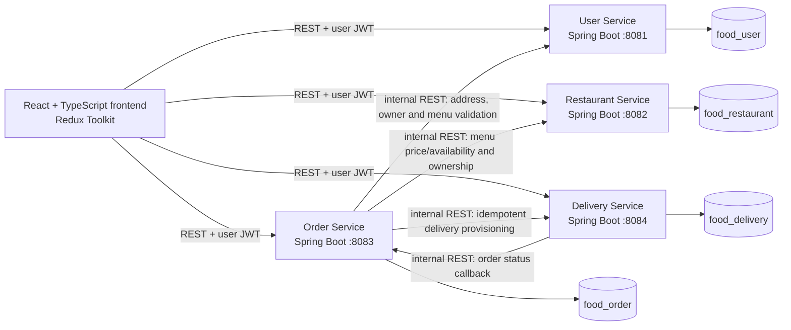
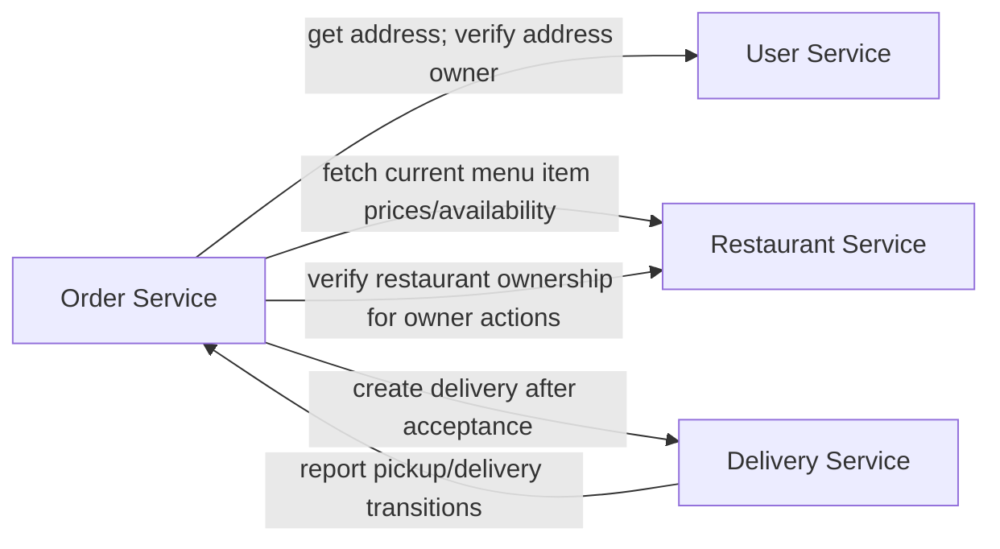

# FoodieExpress Architecture

This document defines the architecture and distinguishes implemented scope from planned workflows. Four independently deployable Spring Boot business services are established; the restaurant-owner-to-delivery lifecycle is implemented across the Order, Restaurant, and Delivery Services. A React/TypeScript/Redux Toolkit frontend calls documented public APIs directly. There is no API Gateway service, broker, or shared cross-service database.

## Component overview

The browser calls services directly. Each service must apply its own authentication, authorization, validation, CORS policy, and error mapping. Client-side state is not trusted as checkout authority.

## Service responsibilities and ownership

| Component | Responsibility | Owns |
|---|---|---|
| Frontend | Render customer, owner, administrator, and demo-delivery workflows; hold the customer cart locally; send user-JWT-authenticated public API requests; display API errors and order/delivery status. | Transient UI state only; no authoritative business records. |
| User Service | Registration, login, JWT issuance, profiles, stored platform roles, addresses, and address ownership. Public/admin role-provisioning and user-management APIs are not implemented. | `food_user`: users and addresses. |
| Restaurant Service | Restaurant profiles and approval state, restaurant-owner association, cuisine data, menu items, prices, and availability. | `food_restaurant`: restaurants and menu items. |
| Order Service | Checkout validation/orchestration, authoritative price lookup, immutable order snapshots, totals, order status transitions, order history, cancellation rules, and delivery-provisioning state. Cart remains local Redux state in MVP. | `food_order`: orders and idempotency records embedded in or associated with orders. |
| Delivery Service | Demo partner assignment, delivery lifecycle, timeline, and order status callbacks after pickup/completion. | `food_delivery`: deliveries and embedded delivery events. |

Services exchange stable identifiers, not database documents or collection access. Order snapshots intentionally duplicate checkout-time values to preserve history.

## Service dependency and synchronous REST flows

The User/Restaurant calls are internal authenticated endpoints, separate from public customer APIs. Restaurant owners submit order status changes to the Order Service; the Order Service verifies ownership using Restaurant Service data. Delivery status is owned by Delivery Service; Delivery calls an internal Order Service endpoint to mirror `OUT_FOR_DELIVERY` and `DELIVERED` on the order. This creates a deliberate synchronous dependency loop between Order and Delivery. The call direction and failure behavior must stay explicit; avoid hidden nested request chains.

### Checkout request flow

1. The frontend submits item IDs and quantities, a saved `addressId`, and `Idempotency-Key`; it does not submit authoritative price, totals, or an arbitrary delivery address as trusted data.
2. Order Service authenticates the customer, fetches the saved address through User Service, and confirms the address belongs to the JWT subject.
3. Order Service fetches current menu data from Restaurant Service, validates restaurant consistency, availability, and quantities, and calculates the price.
4. Order Service writes the order and checkout snapshots in its own database, returning the same result for an identical idempotent retry.
5. Restaurant owner acceptance verifies persisted ownership and atomically persists `CONFIRMED` plus `PENDING` provisioning state, then calls Delivery Service with a short-lived `delivery:create` token and the order ID as idempotency key. Order Service validates the returned order, customer, restaurant, currency, ID, and initial status before storing `deliveryId`; failures retain the confirmed order with `RETRY_REQUIRED`.

## Authentication and authorization

User Service owns credentials, role assignment, and user JWT issuance. Passwords are stored only as a one-way password hash, never returned in a response or logs. Public registration creates a customer role regardless of any role-like fields supplied by a caller. Administrative and restaurant-owner roles are assigned only through protected administrative/ownership workflows.

The user JWT contains a stable user subject, roles, issuer, audience, issued/expiry times, and a token identifier. User Service signs tokens using HS256; each service validates the signature using the same environment-specific Base64-encoded secret and checks issuer, audience, required identity claims, and expiry. `JWT_SECRET` must decode to at least 32 cryptographically random bytes and is required by every service. Because an HS256 verifier can also mint tokens, access to the secret must be tightly restricted; development secrets must never be reused in staging or production. This is a symmetric-signing tradeoff, not a claim that HS256 is inherently more secure than RS256. Previously issued RS256 tokens are incompatible and users must authenticate again after migration. Secret rotation and revocation behavior require an explicit operational plan; short token expiry limits stale authorization.

Order-to-Restaurant calls use a distinct short-lived ES256 internal service JWT with fixed Order Service issuer/subject, Restaurant Service audience, and one operation-specific scope. The Order Service holds the P-256 private key; Restaurant Service holds only the matching public key and cannot mint internal credentials. Order-to-User address lookup uses a second, independent P-256 pair: Order Service holds its private key and User Service holds only its public key. That token uses User Service audience and `user:address:read`; User Service additionally verifies that the requested address belongs to the requested active user. Both pairs are provisioned out of band, use required time claims and a two-minute maximum lifetime, and are separate from the shared HS256 `JWT_SECRET`. Internal tokens are rejected on public routes, and user tokens are rejected on `/internal/**`. No public endpoint issues internal credentials. Transport should use HTTPS outside local development. Centralized service-token issuance remains unimplemented.

Ownership checks:

- A customer may read or cancel only an order whose `customerId` matches the authenticated subject.
- Restaurant-owner order actions are checked by Order Service against Restaurant Service's owner association for the order's `restaurantId`; a role claim alone is insufficient.
- Restaurant profile/menu writes require that the authenticated owner owns the referenced restaurant. Unapproved restaurants remain undiscoverable.
- Delivery actions require an administrator/delivery-operator role or appropriately scoped internal service identity.
- Administrative routes require `ADMIN`; admin authorization is never inferred from user-supplied request data.

## Data ownership and database boundaries

Each service connects only to its logical database: User → `food_user`, Restaurant → `food_restaurant`, Order → `food_order`, Delivery → `food_delivery`. Local MongoDB transactions may provide atomicity within one service/database where configured, but they are **not distributed transactions across four services**. Cross-service data is obtained through API contracts; identifiers and immutable snapshots make data dependencies explicit.

The MVP cart lives in Redux/local client state. It is non-authoritative and may be lost when client state is cleared. Implemented Order Service checkout recalculates totals and validates availability, fetches the saved address through the scoped internal User endpoint, and copies a sanitized snapshot into the order so later address edits do not alter history. Owner transitions are authorized against Restaurant Service's persisted restaurant-owner association. Order-to-Delivery retries are idempotent by order ID; administrator cancellation waits for Delivery Service cancellation and its order callback. Frontend workspaces require known restaurant or delivery IDs because APIs do not list a user's restaurants or an operator's assigned-delivery queue. User-role provisioning remains outside the User Service API. The browser holds only user tokens; service private keys and internal tokens remain server-side.

## Error handling, timeouts, retries, and idempotency

All APIs use the common error structure in [API contracts](api-contracts.md). Calls to other services use configured finite connect/read timeouts and return explicit dependency failures; no indefinite waits. Retry only transient failures, with a small bounded attempt count and backoff, and only for idempotent calls. Do not retry validation/authorization failures or a non-idempotent operation without its idempotency key.

Order creation requires a client `Idempotency-Key`, scoped to the customer and request fingerprint. Same key and same request returns the original order; same key with different content returns `409 Conflict`. Delivery creation is uniquely keyed by `orderId`; repeated create requests return the existing delivery if its payload is consistent.

If delivery provisioning fails after acceptance, Order Service retains `CONFIRMED` and a visible `RETRY_REQUIRED` state. The administrator retry route reuses the same order ID as Delivery Service's idempotency key, so a response lost after a successful write does not create a duplicate.

Delivery persists a pickup/delivery/cancellation event before calling Order Service. If the callback times out, the delivery record retains a pending callback indicator; a repeat of the same status retries the same event ID. Order transitions are idempotent and verify the delivery ID against the order. Delivery and Order use separate directional ES256 key pairs for provisioning/cancellation and status callbacks, respectively, separate from user JWT and Order-to-User/Restaurant keys. Tests cover mocked downstream behavior and MongoDB-backed local workflows. Local runtime verification also passed the complete checkout-to-delivered workflow, duplicate provisioning/callback handling, and retry after an induced Delivery Service outage, using isolated runtime databases. This does not verify production deployment configuration or external infrastructure.

## Trade-offs and limitations

- Synchronous REST keeps the stack small and contracts understandable, but adds runtime availability coupling and latency to checkout/acceptance.
- Direct frontend-to-service calls avoid an unrequested gateway, but require consistent CORS, JWT validation, error handling, and API base URL configuration on every service.
- Four deployable services improve ownership boundaries for this learning project but add operational overhead compared with a monolith.
- Separate service databases prevent accidental cross-service writes but do not provide atomic cross-service workflows or a distributed transaction.
- No broker means recovery is explicit and operator-driven in MVP; a lost process after persistence may require safe retry/reconciliation.
- Demo delivery partners and simulated checkout are not real dispatch or payment processing. Taxes, payment, notifications, GPS, and production service-level objectives are deferred.
- REST timeout, retry, rate-limit, retention, and availability thresholds must be measured/configured during implementation; no unsupported scale guarantees are made.
