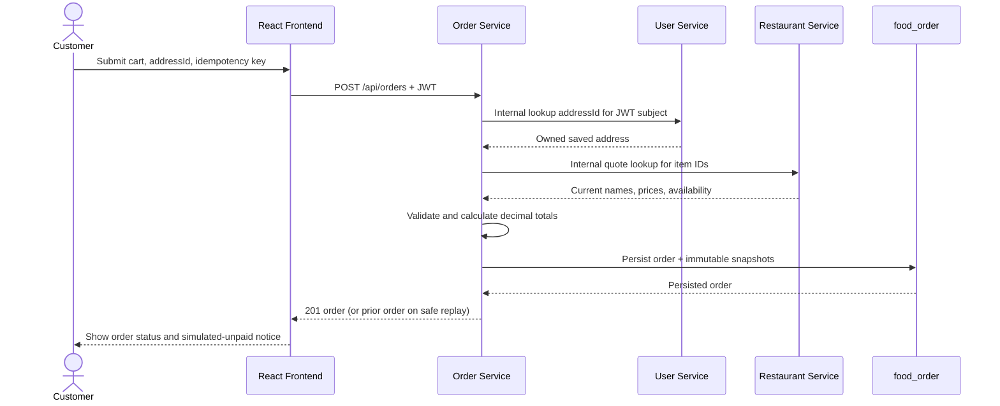

# FoodieExpress Order and Delivery Workflows

This document defines the workflow and ownership of each transition. Order Service owns order status; Restaurant Service owns restaurant/menu state; Delivery Service owns delivery status/events. All service-to-service calls use authenticated REST and stable identifiers.

**Implementation status:** Order Service implements customer checkout/history/cancellation, restaurant-owner listing and transitions, acceptance-triggered Delivery provisioning with retry, administrator pre-pickup cancellation, and the authenticated Delivery callback. Delivery Service implements provisioning, assignment, lifecycle transitions, pre-pickup cancellation, timeline events, and callback retry. The React frontend integrates customer, owner, operator, and admin APIs. Local runtime verification exercised the complete checkout-to-delivered workflow, duplicate checkout/provisioning/callbacks, authorization and cancellation rules, and recovery after Delivery Service became unavailable; data was isolated in dedicated local MongoDB databases. This does not establish production readiness. There is no owner restaurant-list or operator assigned-delivery queue endpoint, so those UI workspaces require a known ID.

## Status model and transition owners

| Current order status | Next status | Initiator / owner | Rules |
|---|---|---|---|
| `PLACED` | `CONFIRMED` | Restaurant owner via Order Service | Only the owning restaurant's owner; delivery provisioning begins after the confirmed state is persisted. |
| `PLACED` | `REJECTED` | Restaurant owner via Order Service | Only before confirmation; rejection reason required; terminal; no delivery is created. |
| `PLACED` | `CANCELLED` | Owning customer via Order Service | Customer may cancel only before restaurant acceptance; terminal. |
| `CONFIRMED` | `PREPARING` | Restaurant owner via Order Service | Must be the next preparation transition. |
| `PREPARING` | `READY_FOR_PICKUP` | Restaurant owner via Order Service | Delivery must be provisioned; if not, keep state unchanged and expose retry-required provisioning. |
| `CONFIRMED`, `PREPARING`, `READY_FOR_PICKUP` | `CANCELLED` | Administrator via Order Service | Allowed only before pickup; when a delivery exists, Order Service waits for Delivery Service cancellation confirmation. Pending cancellation blocks other order transitions. |
| `READY_FOR_PICKUP` | `OUT_FOR_DELIVERY` | Delivery Service callback to Order Service | Only after an assigned delivery records pickup; callback is idempotent by event ID. |
| `OUT_FOR_DELIVERY` | `DELIVERED` | Delivery Service callback to Order Service | Only after delivery completion event; callback is idempotent. |
| Any terminal status | None | — | `REJECTED`, `CANCELLED`, and `DELIVERED` cannot transition further in MVP. |

Order Service rejects skipped, backward, duplicate-conflicting, and unauthorized transitions with `409` or `403`. Repeating an already-applied transition/event is safe and returns the current state. Order status `OUT_FOR_DELIVERY` and `DELIVERED` are projections of Delivery Service events; restaurant owners cannot set these states.

Delivery status is separately owned:

```text
PENDING_ASSIGNMENT -> ASSIGNED -> PICKED_UP -> DELIVERED
       \                               
        -> CANCELLED (before pickup, when authorized)
```

Assignment is handled by `PATCH /api/deliveries/{id}/assign`; pickup and completion use `PATCH /api/deliveries/{id}/status`. The partner is simulated. No GPS tracking is implied.

## 1. Customer registration and login

1. Customer submits email, password, and display name to User Service.
2. User Service validates/normalizes fields, enforces unique email, hashes the password, and assigns only `CUSTOMER`.
3. Login verifies credentials and issues a signed, expiring user JWT.
4. The frontend uses the bearer token for protected calls. Services independently verify the signature, issuer, audience, expiry, roles, and resource ownership.

## 2. Restaurant discovery and menu browsing

1. Frontend requests paginated approved restaurants, optionally filtering by query/cuisine.
2. Restaurant Service returns only `ACTIVE` restaurants and their public details.
3. Frontend requests a restaurant menu; availability and prices reflect current Restaurant Service data.
4. Unavailable menu items may be displayed but are not valid for checkout.

## 3. Add items to cart

The cart is local Redux state in MVP. Each line stores `menuItemId`, `restaurantId`, display name/price for UI, and quantity. Switching to another restaurant requires clearing/replacing the cart or presenting a user-facing confirmation. Cart values are conveniences only: the backend ignores client-supplied names/prices/totals and validates current menu data at checkout. Cart persistence on the server is deferred.

## 4. Checkout and order creation

The customer submits `restaurantId`, a bounded list of `{menuItemId, quantity}`, a saved `addressId`, and an `Idempotency-Key`. **Implemented:** Order Service authenticates the user, fetches the address for that user from User Service using the scoped internal endpoint, fetches current prices and availability from Restaurant Service, checks all items belong to the one restaurant, and computes USD totals using `BigDecimal`. It stores the order and immutable item/address snapshots in `food_order`; no payment is processed. The response begins in `PLACED` / `SIMULATED_UNPAID`.



On repeated submission with the same key and same normalized request, Order Service returns the original order rather than creating another. Reuse with a changed request returns `409`. Failed validation or upstream lookup creates no order. If the client times out after a successful write, it retries with the same key to retrieve the result. Customer history/detail are filtered by verified JWT subject; an order owned by another customer is concealed as `404`. Cancellation is an atomic transition from `PLACED`; invalid states return `409`.

## 5. Restaurant acceptance or rejection

The owner lists orders for a restaurant with `GET /api/orders/restaurant/{restaurantId}` and submits `CONFIRMED` or `REJECTED` through `PATCH /api/orders/{id}/restaurant-status`. Order Service verifies ownership against Restaurant Service using the order's stored restaurant ID and accepts only a `PLACED` order. Rejection records a reason and terminates the workflow without delivery provisioning. Acceptance first persists `CONFIRMED` and `PENDING`, then requests delivery creation; the order is not rolled back if that downstream request fails.

The restaurant pickup location is fetched from the scoped internal Restaurant Service endpoint. The restaurant schema has no pickup contact phone, so that field is stored as null; customer dropoff contact data comes from the immutable order address snapshot.

```mermaid
sequenceDiagram
    actor Owner as Restaurant Owner
    participant Order as Order Service
    participant OrderDB as food_order
    participant Delivery as Delivery Service
    participant DeliveryDB as food_delivery
    Owner->>Order: PATCH /api/orders/{id}/restaurant-status (CONFIRMED)
    Order->>Order: Verify owner and PLACED transition
    Order->>OrderDB: Persist CONFIRMED + provisioning state
    Order->>Delivery: POST /api/deliveries (internal, orderId key)
    alt Delivery created or already exists
        Delivery->>DeliveryDB: Persist one delivery by unique orderId
        Delivery-->>Order: Delivery ID and PENDING_ASSIGNMENT
        Order->>OrderDB: Record deliveryId, provisioning COMPLETE
        Order-->>Owner: 200 CONFIRMED
    else Timeout or unavailable
        Delivery-->>Order: Timeout/unavailable
        Order->>OrderDB: Mark RETRY_REQUIRED; retain CONFIRMED
        Order-->>Owner: 202 CONFIRMED, fulfillment pending
    end
```

Delivery creation is only initiated after acceptance; rejected/cancelled-before-acceptance orders have no delivery. Delivery Service enforces a unique `orderId`. If its write succeeds but the response is lost, retrying with the same order ID returns that existing record.

## 6. Food preparation and ready-for-pickup

After confirmation, restaurant owner advances `CONFIRMED → PREPARING → READY_FOR_PICKUP`. Order Service validates the sequence and ownership. The `READY_FOR_PICKUP` transition is blocked until delivery provisioning is complete. Status requests cannot skip preparation or set delivery-owned statuses.

## 7. Delivery assignment, pickup, and completion

An administrator/delivery operator assigns a configured demo partner to a `PENDING_ASSIGNMENT` delivery. The delivery operator records `PICKED_UP` after pickup. Delivery Service persists a uniquely identified timeline event, then calls Order Service's internal callback to set `OUT_FOR_DELIVERY`. On completion, Delivery Service similarly persists `DELIVERED` and notifies Order Service to set order status `DELIVERED`. Callback retries use the same event ID and are idempotent. Customer tracking reads delivery status/timeline; it does not show live location.

The Order callback additionally requires that the order already stores the matching `deliveryId` and is in the expected lifecycle state. Restaurant-owner delivery-detail reads are not part of the current contract; delivery details remain available to customers, delivery operators, and administrators under the existing access policy.

## 8. Cancellation

Customers can cancel only `PLACED` orders. A restaurant rejection is represented as `REJECTED`, not a customer cancellation. Admin cancellation is permitted only before pickup (`CONFIRMED`, `PREPARING`, `READY_FOR_PICKUP`) and requires a reason. If delivery provisioning is pending or retry-required, Order Service first replays idempotent delivery creation to resolve whether a record exists; it never treats a missing `deliveryId` after a timeout as proof that no delivery was written. With a delivery, it records `cancellationStatus: PENDING`, blocks further restaurant transitions, and asks Delivery Service to cancel. Order status becomes `CANCELLED` after Delivery Service has persisted cancellation and its callback is applied. If the delivery callback is delayed, the order remains explicitly cancellation-pending; if the request fails, `RETRY_REQUIRED` remains visible and the administrator may safely repeat `PATCH /api/admin/orders/{id}/cancel`. No cancellation is allowed after `OUT_FOR_DELIVERY` in MVP.

## 9. Service failure and recovery

Every inter-service call has finite connect/read timeouts. Retry only transient errors with a small bounded policy and only idempotent requests. Do not retry invalid requests, authorization failures, or checkout with a different key.

```mermaid
sequenceDiagram
    participant Owner as Restaurant Owner
    participant Order as Order Service
    participant ODB as food_order
    participant Delivery as Delivery Service
    participant DDB as food_delivery
    Owner->>Order: Accept order
    Order->>ODB: Persist CONFIRMED, provisioning PENDING
    Order->>Delivery: Create delivery (stable orderId key)
    Delivery--xOrder: Timeout or connection failure
    Order->>ODB: Mark RETRY_REQUIRED; retain confirmed order
    Order-->>Owner: 202 fulfillment pending
    Note over Order,Delivery: Admin retries via POST /api/orders/{id}/delivery-provisioning/retry
    Order->>Delivery: Retry create for same orderId
    alt First attempt never persisted
        Delivery->>DDB: Insert delivery (unique orderId)
    else First attempt persisted but reply was lost
        Delivery->>DDB: Find existing delivery by unique orderId
    end
    Delivery-->>Order: Existing/new delivery ID
    Order->>ODB: Mark provisioning COMPLETE
```

If Delivery Service persists a pickup/completion event but its callback to Order Service fails, it retains a pending callback marker and retries the same event ID. The order may temporarily lag the delivery record; the UI should display the delivery source-of-truth and a pending synchronization indication rather than inventing an order transition. A manual, authorized retry/reconciliation is part of MVP operations. There is no distributed MongoDB transaction, message broker, or claim of automatic eventual recovery.
